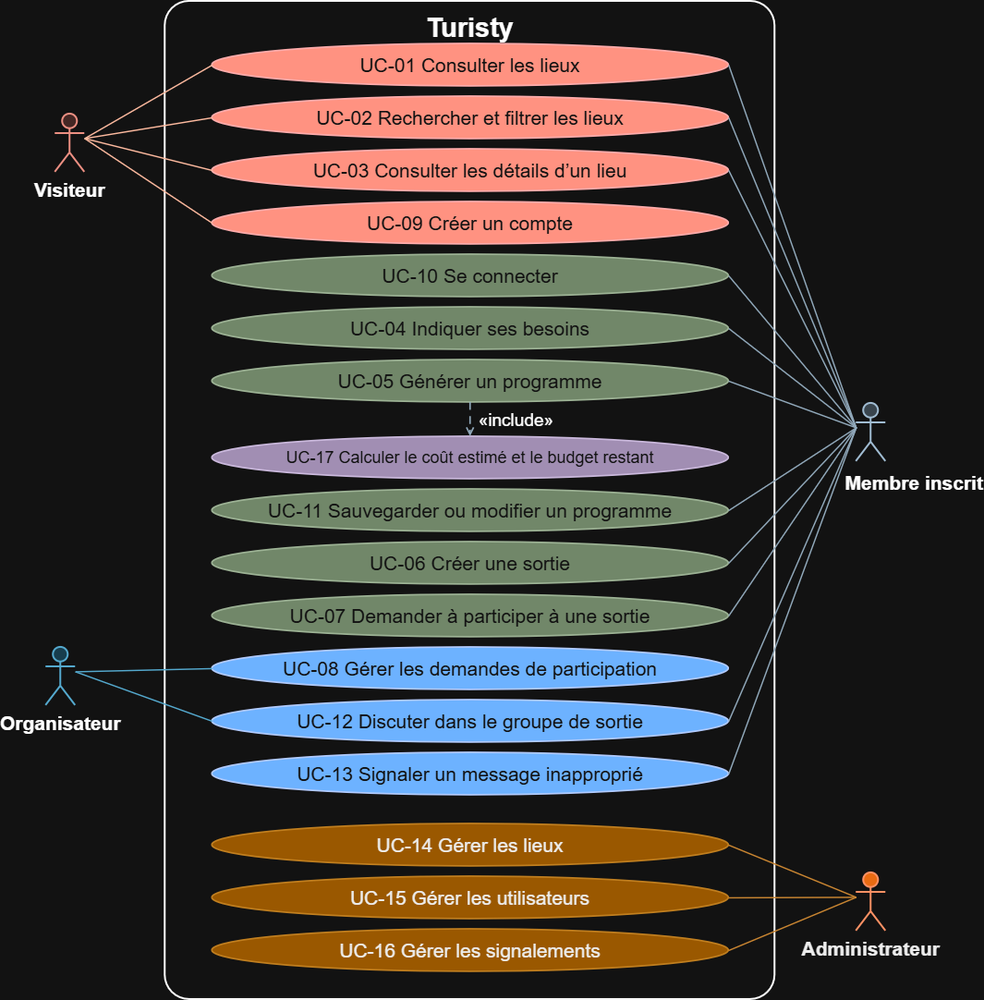
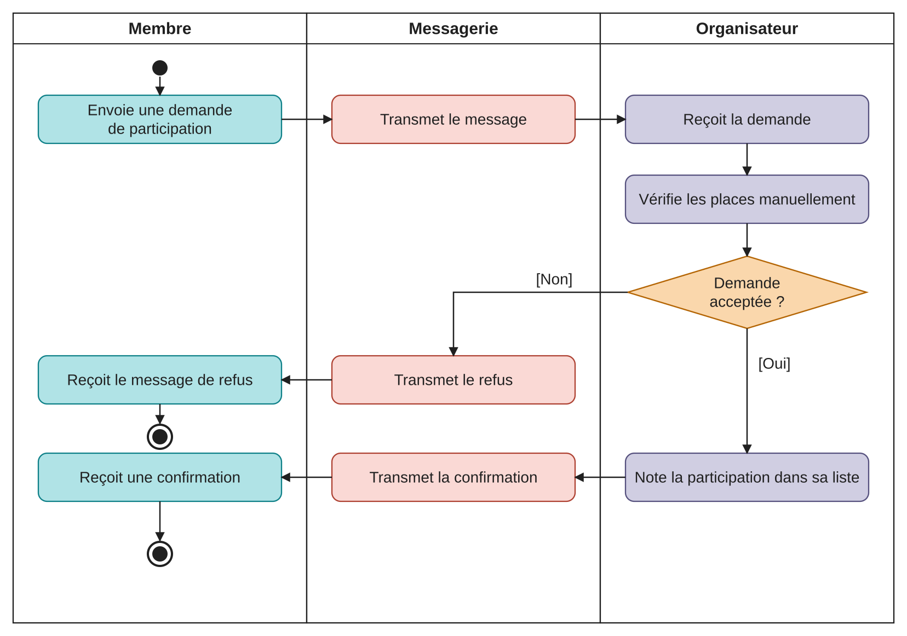
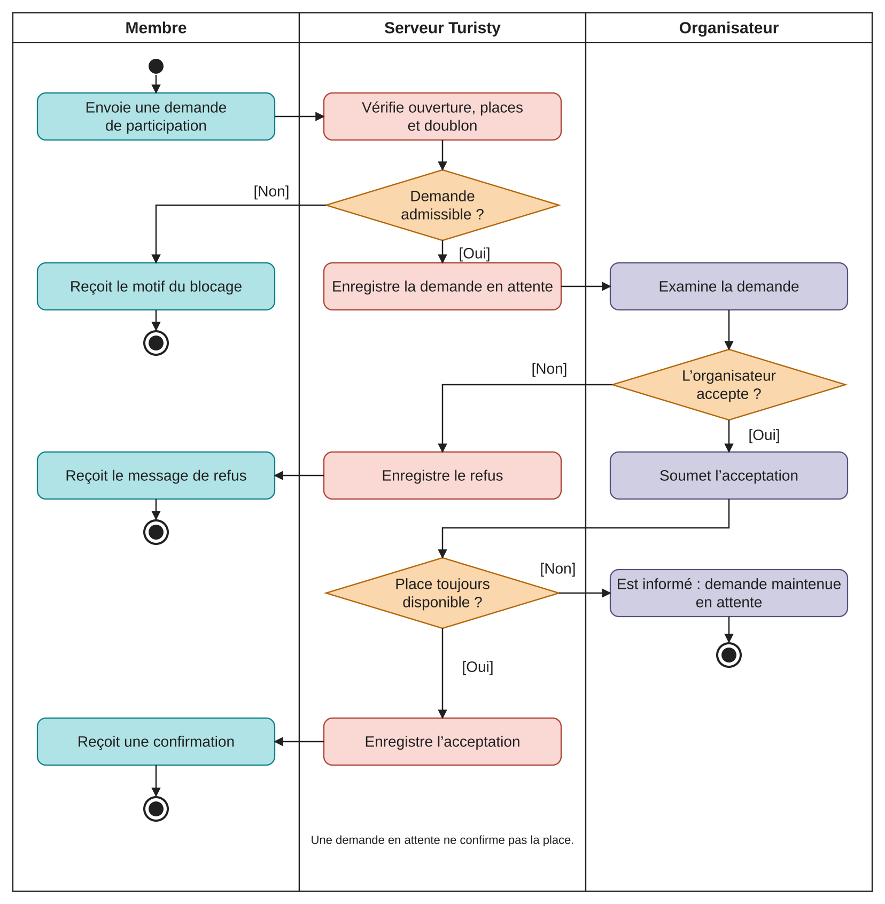

# Soumission 2 — Turisty

## Cahier des charges et backlog

[Consulter le cahier des charges v0.2 et le Product Backlog](./Cahier%20De%20Charges%20-%20SRS.md)

### Changements depuis la soumission 1

- Le filtre par tranche d’âge a été ajouté à la portée.
- Le cahier précise que Turisty génère un programme de 1 à 3 jours et affiche son coût estimé ainsi que le budget restant.
- Le traitement des demandes de participation a été précisé : un membre peut demander une place, une demande en double est bloquée et l’organisateur accepte ou refuse la demande de sa sortie.
- L’accès au groupe de discussion est réservé à l’organisateur de la sortie et aux membres acceptés. Le signalement concerne un message que le membre est autorisé à lire.

## Diagramme général de cas d’utilisation

Le diagramme montre les fonctions de Turisty du point de vue du visiteur, du membre inscrit, de l’organisateur et de l’administrateur. Par exemple, un visiteur peut filtrer les lieux, un membre peut générer un programme et l’organisateur peut traiter les demandes pour sa sortie.

## Fiches de cas d’utilisation

[Consulter les fiches de cas d’utilisation — Word](./diagrammes/Turisty_use%20Case%20Specifications.docx)

- **UC-02 — Rechercher et filtrer les lieux (US-02, FR-2).** Le visiteur recherche des lieux sans avoir besoin d’un compte. La fiche présente les filtres et explique quoi faire si le budget saisi est invalide ou si aucun lieu ne correspond.
- **UC-05 — Générer un programme (US-05, FR-8).** Le membre connecté indique ses besoins. Turisty vérifie les données, propose un programme de 1 à 3 jours et affiche le coût estimé et le budget restant. La sauvegarde est une action séparée.
- **UC-08 — Gérer les demandes de participation (US-08, FR-10).** L’organisateur accepte ou refuse une demande pour sa sortie. Turisty revérifie les places avant de confirmer une acceptation.

Chaque fiche présente l’acteur, l’objectif, les préconditions, le déclencheur, le scénario principal, les exceptions, les postconditions et un exemple de vérification.

## Diagrammes d’activité — Participation à une sortie

Les deux diagrammes portent sur le même processus, de l’envoi de la demande jusqu’à son traitement. Le parcours relie **UC-07 — Demander à participer à une sortie** et **UC-08 — Gérer les demandes de participation**.

### AS-IS — Traitement par messagerie

Dans le scénario de référence, le membre envoie une demande par messagerie. L’organisateur vérifie les places manuellement et prend sa décision. S’il accepte, il note la participation dans sa liste et transmet une confirmation. S’il refuse, le membre reçoit un message de refus.

### TO-BE — Traitement avec Turisty

Turisty vérifie que la sortie est ouverte, qu’une place est disponible et que le membre n’a pas déjà envoyé une demande pour cette sortie. Si la demande est admissible, elle est enregistrée avec le statut « En attente ». L’organisateur l’examine et décide de l’accepter ou de la refuser. S’il choisit de l’accepter, Turisty revérifie la disponibilité. Si la dernière place a été prise entre-temps, la demande reste en attente et l’organisateur en est informé.

### Justification des améliorations

Dans l’AS-IS, l’organisateur vérifie les places et met sa liste à jour lui-même. Dans le TO-BE, Turisty filtre les demandes non admissibles et conserve leur statut au même endroit. La deuxième vérification des places est nécessaire parce que la disponibilité peut changer entre l’envoi de la demande et son traitement. L’organisateur garde la décision : il n’y a pas d’auto-approbation.

## Modèle de données

Le modèle relie les comptes aux programmes et aux sorties. Les étapes relient les programmes aux lieux du catalogue. Une sortie a un organisateur et un nombre maximal de places. Les demandes sont liées à une sortie et à un compte. Les messages sont liés à une sortie et à leur auteur, et un signalement référence le message concerné et le compte qui le signale.

### Justification de la normalisation

**Programmes, étapes et attractions.** Nous avons séparé `program`, `Etape` et `Attraction` parce que leurs données ne décrivent pas la même chose. Le budget et la durée appartiennent au programme, le numéro du jour appartient à l’étape, et le nom, l’adresse et le prix appartiennent au lieu. `Etape` contient les références `IdProgram` et `IdAttraction` au lieu de recopier les données de ces deux tables.

**Anomalie de mise à jour évitée.** Si le même lieu est prévu dans deux programmes, les deux étapes référencent le même `IdAttraction`. Si l’adresse du lieu change, nous la modifions une seule fois dans `Attraction`. Si elle était recopiée dans chaque étape, une ancienne adresse pourrait rester dans un programme. La séparation permet aussi d’ajouter un lieu au catalogue sans devoir créer un programme pour l’y placer.

**Comptes, sorties et demandes.** Dans `Demande`, le statut concerne à la fois le compte et la sortie. En revanche, le courriel dépend seulement du compte, et la date et le nombre maximal de places dépendent seulement de la sortie. Ces informations restent donc dans `Compte` et `Sortie`. La clé composée (`IdSortie`, `IdCompte`) empêche un même compte d’avoir deux demandes pour la même sortie tout en permettant à plusieurs comptes de demander une place.

**Messages et signalements.** `Signalement` conserve la référence du message plutôt que de recopier son contenu. Le statut du signalement reste dans `Signalement`, car il décrit le traitement de ce signalement, pas le message lui-même.

## Rapport de progression

[Consulter le rapport de progression (Word)](./Rapport_Progression_Turisty_Soumission2.docx)